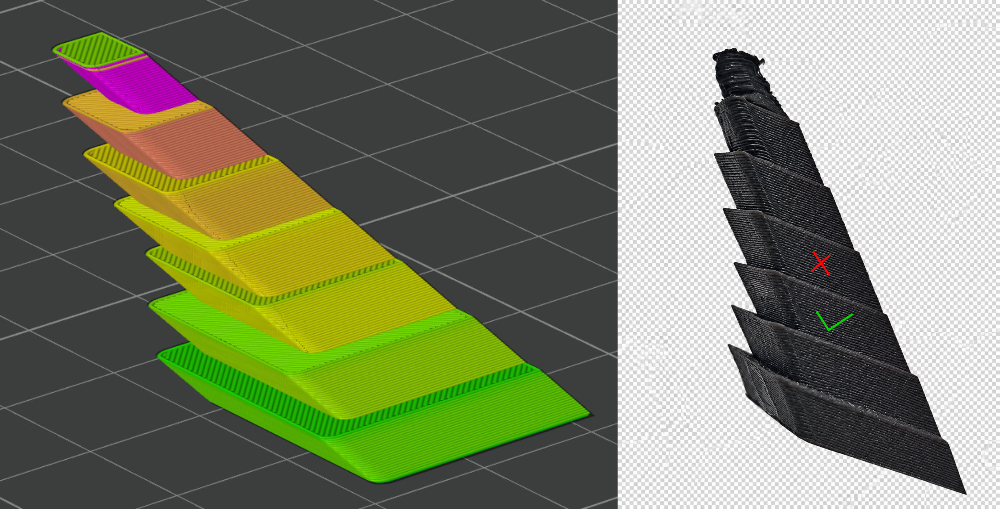

# Cooling

> Reference: [Bambu Studio Auto Cooling documentation (Bambu Wiki)](https://wiki.bambulab.com/en/software/bambu-studio/auto-cooling)

**Applicable to:**

- Rigid plastics (PLA, PETG, ABS, PA, etc.)
- Most FDM 3D printers

---

## Purpose

1. Find the shortest printable layer time at different fan speeds.
2. Use the result to set reasonable fan-threshold parameters ($Fan_{\text{min}}$, $Fan_{\text{max}}$, $Layer_{\text{min}}$, $Layer_{\text{max}}$) that reduce warping and improve accuracy and detail.

---

## Principle

1. A 45° overhang pyramid printed at 50 mm/s is used to create a range of layer times. Fan power is then varied to find the minimum and maximum fan speeds and their corresponding layer times for the material.
2. PLA (polylactic acid) is a semi-crystalline, low-glass-transition material ($T_g \approx 60^\circ C$). Unlike engineering plastics such as ABS or ASA, PLA needs rapid cooling after extrusion to solidify. Because PLA's $T_g$ is usually between 50 °C and 60 °C, insufficient cooling can soften the filament inside the heatbreak and cause a clog. At the same time, PLA keeps excellent interlayer bonding even with heavy cooling, so most manufacturers (including Bambu Lab) set the minimum fan speed to 100% or close to it by default. Therefore, cooling calibration for PLA only needs to find the maximum fan-speed threshold.

---

## Variable Definitions

| Variable | Symbol | Description |
|-|-|-|
| Minimum Fan Speed | $Fan_{\text{min}}$ | Lower bound of the fan speed range (%). |
| Maximum Fan Speed | $Fan_{\text{max}}$ | Upper bound of the fan speed range (%). |
| Minimum Fan Speed Threshold Layer Time | $Layer_{\text{min}}$ | Layer time threshold below which minimum fan speed is applied (s). |
| Maximum Fan Speed Threshold Layer Time | $Layer_{\text{max}}$ | Layer time threshold above which maximum fan speed is applied (s). |

---

## Preparation

1. Dry the filament thoroughly.
2. Edit the filament profile: set the **nozzle temperature** to the highest printable temperature for the material, enable **keep fan always on**, disable **slow down print for better cooling**, and disable **force cooling for overhangs/bridges**.

---

## Procedure

### PLA / TPU Procedure

1. **Model**: from **model library**, download the **cooling fillet** model.
2. **Fan settings**: Fix the fan at **100%**, and set both the **maximum fan speed threshold** and the **minimum fan speed threshold** to 100%.
3. **Preview check**: After slicing, confirm that the **fan**, **layer time**, and **temperature** settings match the intended values.
4. **Observe and record**: find the **shortest printable layer time** that still prints without obvious curling (see example picture for reference), and record 
   - $Layer_{\text{max}} = $ shortest printable layer time
   - $Fan_{\text{max}} = 100\%$
   - $Fan_{\text{min}} = 100\%$
   - $Layer_{\text{min}} = 100\,\text{s}$ (standard value)

### Non-PLA Procedure

1. **Model**: from **model library**, download the **cooling fillet** model.
2. **Fan settings**: fix the fan at **0%**, and set both the **maximum fan speed threshold** and the **minimum fan speed threshold** to 0%.
3. **Preview check**: after slicing, confirm that the **fan**, **layer time**, and **temperature** settings match the intended values.
4. **Observe and record**: find the shortest layer time $\tau$ that still prints without obvious curling (see example picture for reference).
   - Case 1: If $\tau \le 6\,\text{s}$, record $Fan_{\text{max}} = 0\%$; $Fan_{\text{min}} = 0\%$; $Layer_{\text{min}} = 6\,\text{s}$ (standard value); $Layer_{\text{max}} = 100\,\text{s}$ (complete);
   - Case 2: If $\tau > 6\,\text{s}$, record $Layer_{\text{min}}=\tau$, with $Fan_{\text{min}} = 0\%$;
   - Case 3: If no $\tau$ is found, it means the material requires active cooling. Increase the fan in 10% steps until a $\tau$ is found. Record $Layer_{\text{min}}=\tau$, with $Fan_{\text{min}} =$ the corresponding fan speed.

5. **Find fan max and layer time max**: if the previous step ends in case 2 or case 3, keep increasing the fan in 10% steps, find the lowest fan speed that can print a **6 s layer time**. Record $Layer_{\text{max}} = 6\,\text{s}$ and $Fan_{\text{max}} =$ the corresponding fan speed.

---

## Notes

- Make sure the test conditions match the actual printer and material used.
- Change one variable at a time (fan speed or layer time).
- Keep raw data and conclusions well organized for traceability and profile deployment.
- Use the results to optimize slicer fan parameters and layer-time strategy.

---

## Why 6 Seconds? (Background)

- Most test models reach a **shortest layer time of about 2 s** (for example, the boat chimney and the sharp tower in the comprehensive model).
- When **slow print for better cooling** is enabled, print speed is clamped to the **minimum print speed** (typically 10 mm/s), which stretches a 2 s layer to about 6 s.
- Therefore, **6 s is used as the acceptable shortest-layer-time benchmark** in this workflow.
