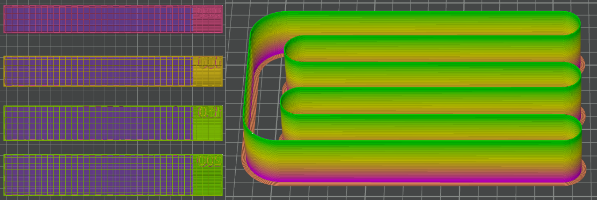
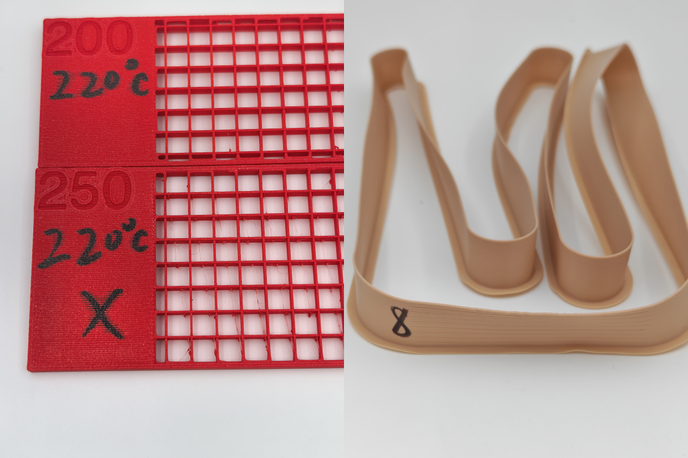

# Max Volumetric Speed (max-speed)

**Applicable to:**

- Rigid and semi-rigid plastics (flexible plastics require the S-path test)
- Most 3D printers
- Printers with Sparse infill acceleration $\ge 3000\;\text{mm/s}^2$

---

## Purpose

Find the maximum volumetric flow rate the hot end can reliably and consistently extrude. This prevents under-extrusion, voids, weak points, and uneven layers during high-speed printing, helping maintain print quality.

## Principle

Grid sparse infill is printed at different volumetric flow rates. Once the flow exceeds the hot end's melt limit, under-extrusion appears and the internal infill layers do not bond well, creating voids. After printing, hold the sample against a steady light source and check whether light passes through the internal crossing area. Light leakage means the extrusion was unstable at that speed. The last speed with no leakage is taken as the maximum reliable speed.

For flexible materials, the grid sparse infill method often over estimates the max volumetric speed. Therefore, the S-path model (built-in for most slicers) is used for flexible materials. Print speed is increased in steps by layers. Once flow rate exceeds the buckling limit of the filament, under-extrusion would happen, which leads to rough surface. The transition from smooth to rough surface is taken as the maximum reliable speed. 

## Preparation

1. Dry the filament thoroughly.
2. In the slicer's process settings, confirm **Sparse infill acceleration** $\ge 3000\;\text{mm/s}^2$.
2. Edit the filament profile:
   - Disable **Slow down for better cooling**.
   - Set **Max volumetric speed** $= 500 \;\text{mm}^3\text{/s}$ to remove the slicer-side flow limit.
   - Set **printing temperature** and **cooling parameters** according to the previous test results.

## Procedure

1. **Model selection**: 
   - Rigid materials: downlaod the **max-speed-rigid** model from the **model library**.
   - Flexible materials: use the built-in **Max flowrate** model.
2. **Slicer settings**:
   - Disable **Slow down for better cooling**.
   - Set **Max volumetric speed** $= 500 \;\text{mm}^3\text{/s}$ to remove the slicer-side flow limit.
   - Set **printing temperature** and **cooling parameters** according to the previous test results.
3. **Preview check**: After slicing, verify that 
   - **temperature** and **print speed** match the intended values;
   - **infill** are set to grid, and that the **infill direction** is 90°.
4. **Observe and record**: 
   - Rigid materials: hold the printed sample up to a stable light source and examine the **internal crossing area** for light leaks. If light leaks through, mark that speed as NG.If no light leaks, mark it as G. The maximum speed that is G is taken as the max print speed. Convert the print speed to volumetric speed according to the *Volumetric Flow Calculation and Notes* section, and record the max volumetric speed.
   - Flexible materials: examine the printed sample surface and locate the layer where transition from smooth to rough happens. Compute the volumetric speed at the transition, and mark the speed on the printed sample.

## Process record

The following pictures are examples of good max volumetric speed test process records. 

---

## Volumetric Flow Calculation and Notes

### Slic3r-based Slicers

**Cross-sectional area formula**

$$A = m_{\text{height}} \times \Big(m_{\text{width}} - m_{\text{height}} \times (1 - 0.25\pi)\Big)$$

**Volumetric flow formula**

$$Q_{\text{max}} = v \times A \; (\text{mm}^3/\text{s})$$

Where:

- $m_{\text{height}}$: layer height (mm)
- $m_{\text{width}}$: line width (mm)
- $v$: line speed (mm/s)

---

### Example (Slic3r-based)

Assume $m_{\text{height}} = 0.2$ mm, $m_{\text{width}} = 0.45$ mm, and $v_{\text{ok}} = 200$ mm/s:

1. Calculate the cross-sectional area:

$$A = 0.2 \times \Big( 0.45 - 0.2 \times (1 - 0.25\pi) \Big) \approx 0.0814 \; \text{mm}^2$$

2. Calculate the volumetric flow rate:

$$Q = 200 \times 0.0814 \approx 16.28 \; \text{mm}^3/\text{s}$$

---

### Non-Slic3r-based Slicers

- Read the **volumetric flow rate** ($\text{mm}^3/\text{s}$) directly from the slicer preview or G-code analysis.
- Use the volumetric flow rate of the fastest no-NG level as $Q_{\text{max}}$; no extra calculation is needed.
