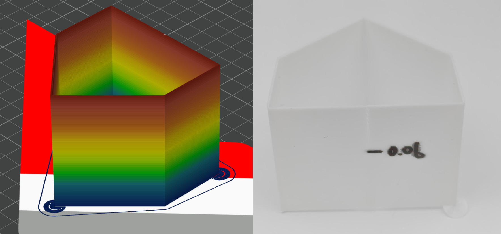

# Pressure Advance

> Reference: [OrcaSlicer Wiki — Pressure Advance Calibration](https://github.com/SoftFever/OrcaSlicer/wiki/pressure-advance-calib)

**Applicable to:**

- Hard / semi-hard materials (PLA, PETG, PA-CF, etc.): use PA Tower.
- Flexible plastics (TPU, TPEE, etc.): use PA Pattern.
- Only for printers and firmware that support Pressure Advance / K-Factor.

---

## Purpose

Determine the optimal Pressure Advance value, mitigating under- / over-extrusion in acceleration / deceleration processes.

## Preparation

1. Dry the filament thorougly.
2. Enable **Developer Mode** in the slicer preferences and ensure that **Calibration** menu shows up.

2. Open the **Calibration** menu and select **Pressure Advance Calibration**.
3. Choose **PA Tower** for rigid filaments or **PA Pattern** for flexible filaments.
4. Set `PA_start` to 0, `PA_end` to 1, and `PA_step` to 0.002.

## Procedure

1. **Model**: Open the **Calibration** menu and select **Pressure Advance Calibration**.
   - Rigid materials: choose **PA Tower**
   - Flexible materials: choose **PA Line** or **PA Pattern**
2. **Slicer settings**: 
   - Set `PA_start` to 0, `PA_end` to 0.1, and `PA_step` to 0.002.
   - Set temperature, cooling, maximum volumetric speed, and flow ratio based on previous calibration results.
2. **Preview and check**: After slicing, ensure that temperature, cooling, print speed, and flow ratio match the intended values.
3. **Observe and record**: 
   - Rigid materials (tower method): 
      - Examine the front corner and the back seam. The front corner should be close to a right angle and the transitions on both sides should look even. The back seam should be flat, without under-extrusion or over-extrusion;
      - Find where the overall quality is the best,  measure the height in mm,  (in PA tower, each step is 1 mm, so the height value in mm is equivalent to the step number $n$);
      - Calculate PA: $PA = PA_{\text{start}} + PA_{\text{step}} \times n$. Mark the calculated PA value on the test model, and update the PA value in filament settings.
   - Flexible materials:
      - Line method: Choose the value corresponding to the most even line and update the PA value in the filament settings.
      - Pattern method: Choose the value corresponding to the most uniform pattern, with no breaks or bumps. Update the PA value in the filament settings.

## Process record

- Tower: a picture of the printed model back seam, with calculated PA value marked.
- Line, pattern: a picture of the printed model.

## Examination reference

1. PA too low
2. PA too high
3. Best PA

For Tower and Line examination references, see [OrcaSlicer Wiki — Pressure Advance Calibration](#pressure-advance) cited at the beginning of this section.