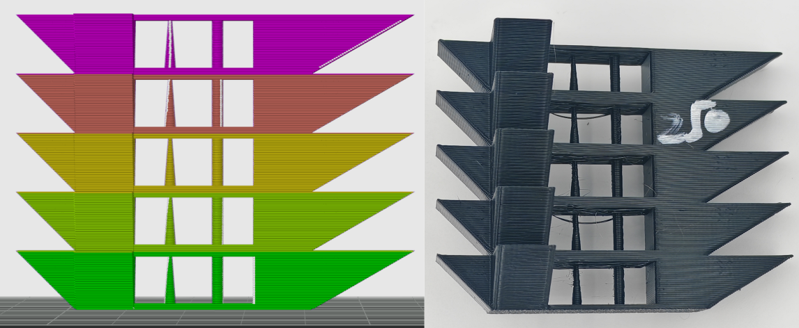
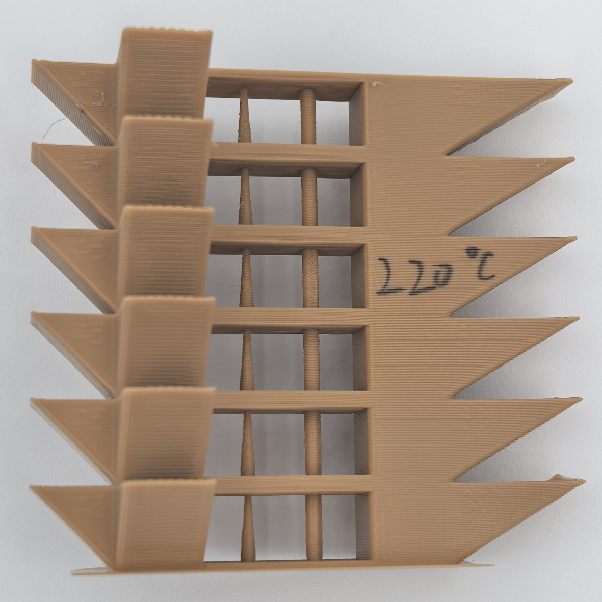

# Temperature Tower

**Applicable to:**

- All materials
- Most FDM 3D printers

---

## Purpose

1. Find a reasonable print-temperature range for the filament.
2. Use the result to set a suitable **nozzle temperature** and **recommended nozzle-temperature range**, reducing stringing, cracking, and warping while improving accuracy and detail.

---

## Principle

A model containing stringing, bridge and overhang is printed repeatedly at different temperatures. `M104` commands are inserted between layers to change the nozzle temperature. By comparing the quality of various features, a optimal print temperature is selected.

---

## Preparation

1. Dry the filament thoroughly.
2. Download **temperature-tower** model from **model library**, use "flexible" version for flexible materials (e.g. TPU), and use "rigid" version otherwise.

---

## Procedure

1. **Slicer settings**: 
   - Set fan thresholds according to the results of the cooling calibration, enable **keep fan always on**, disable **slow down print for better cooling**, and disable **force cooling for overhangs/bridges**.
   - Set the **nozzle temperature** in the filament profile to the highest printable temperature for the material. 
   - Set all relevant speeds at 50 mm/s.
   - (flexible only) Set retraction length at 0.8 mm.
   - After slicing, insert an `M104 Sxx` command every 50 layers to lower the temperature by 10 °C. (For example, if the highest PLA print temperature is 250 °C, add `M104 S240` at layer Z=50, `M104 S230` at Z=100, and so on.)
2. **Preview check**: After slicing, confirm that the **temperature**, **print speed**, and **cooling** settings match the intended values.
3. **Observe and record**: 
   - For rigid materials: if there exists a temperature band, where overhang, stringing and bridging qualities are best among all bands, record this temperature as the nozzle temperature. If several temperatures perform equally well, choose the highest one to preserve mechanical strength.
   - For flexible materials: if all temperature bands show equally bad stringing quality (or surface defects), adjust retraction length within 0.4-1.2 mm. Typically, by reducing retraction length, surface defects can be mitigated; by increasing retraction length, stringing can be mitigated.

## Process record

Mark the temperature value on the selected temperature band, and take a picture from the mark side.

