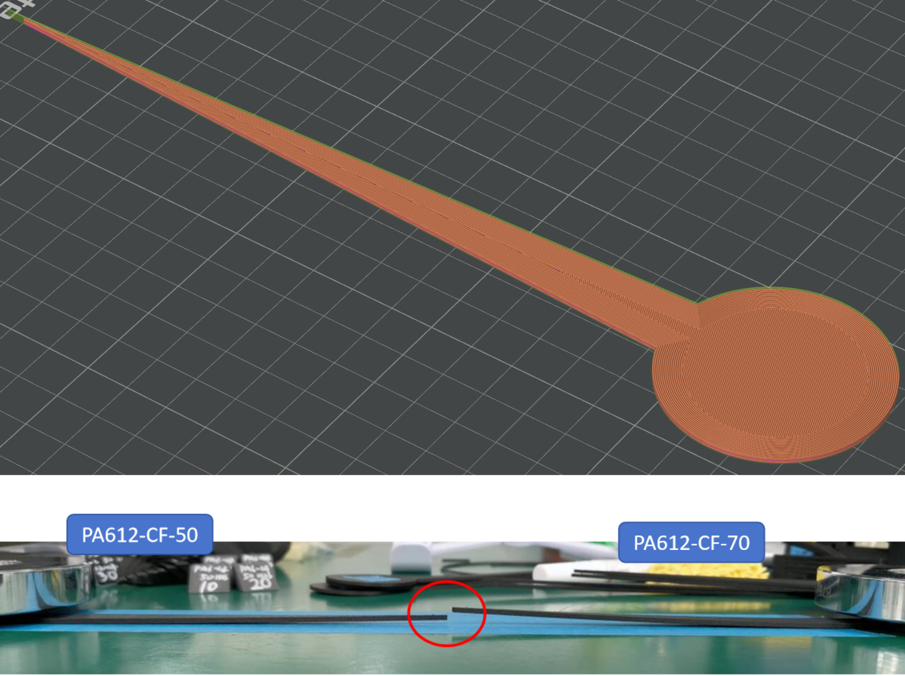

# Bed Temperature

**Applicable to:**

- Warp-prone engineering plastics (ABS, PA, PC, etc.)
- All printers

{height=3in}

---

## Purpose

Find a bed temperature that minimizes warpage.

Notes：

- Use this method only if the material being tested is very prone to warping.
- It is recommended to clean the print bed thoroughly before the test.
- Refrain from using glue in this test, unless it is absolutely necessary.

## Principle

A key-shaped model with a sharp tip is printed at different bed temperatures to determine a bed temperature that minimizes warpage. Due to stress concentration, the sharp tip of the model detaches from the hot bed upon tiny tendency of shrinkage. From then on, most residual stress tend to release near the sharp tip, making it curl up. By comparing the extent of the curling of models printed at different bed temperatures, one can tell which bed temperature provides better adhesion.

## Preparation

1. Dry the filament thoroughly.
2. Download **key-warp** model from the **model library**.

## Procedure

1. **Slicer settings**: set bed temperature to the lowest printable bed temperature, fan speed to 0, wall loops to 15, outer / inner wall speed to 100.
2. **Preview check**: after slicing, confirm that the bed temperature, wall loops and speed settings match the intended values.
3. **Observe and record**
    - case 1: if the sharp tip does not curl up, record the current bed temperature as the bed temperature (complete);
    - case 2: if the sharp tip does curl up, record the current bed temperature as the candidate. Increase the bed temperature in steps of 10℃ and print the key model, until maximum printable bed temperature is reached. At each step:
        - case 2.1: if current curling distance $<$ previous curling distance, update the candidate with the current bed temperature;
        - case 2.2: if current curling distance $\ge$ previous curling distance, do not update.

## Process record

Take picture(s) of key-shaped models printed at different temperature side-by-side. Label the corresponding bed temperatures so one can tell clearly which bed temperature performs better in terms of warpage (see the graphic abstract of this section for an example).