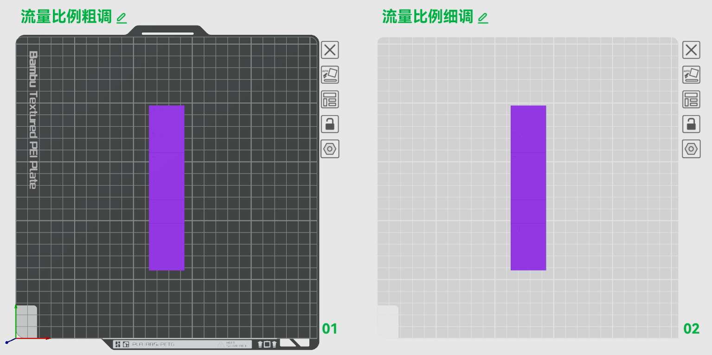
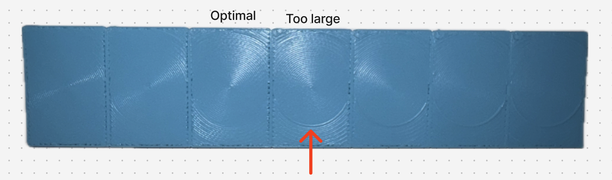
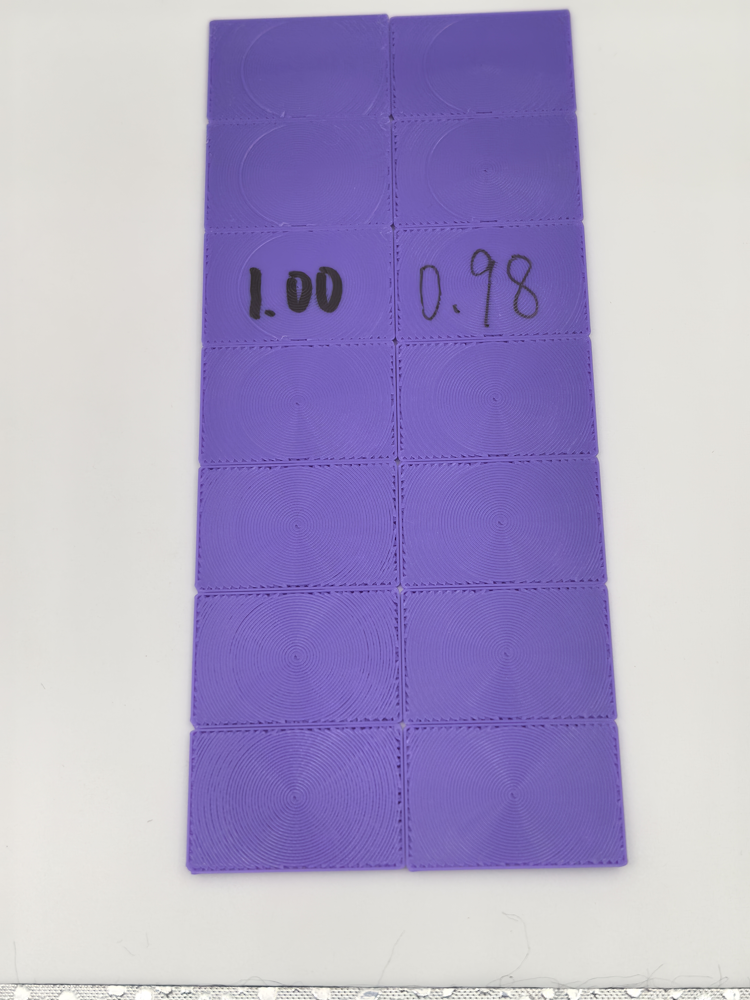

# Flow Ratio

> References: [Bambu Studio Flow Rate Calibration](https://wiki.bambulab.com/en/software/bambu-studio/calibration_flow_rate) | [Reddit Guide](https://www.reddit.com/r/BambuLab/comments/1astmkp/easy_to_follow_flow_ratio_calibration/)

**Applicable to:**

- All materials
- Most 3D printers

{height=3in}
{height=3in}
---

## Purpose

1. **Improve surface quality**: Remove top-surface ripples, blob protrusions, and nozzle drag marks caused by over-extrusion, and fix gaps, unclosed lines, and rough surfaces caused by under-extrusion.
2. **Maintain dimensional accuracy**: Keep solid infill density and wall thickness within specification and control dimensional error.
3. **Improve process stability**: Establish an accurate flow baseline, which is a necessary prerequisite for tuning advanced parameters such as Pressure Advance.

## Principle

A series of patches with increasing flow ratios is printed. By evaluating the top-surface quality, the best flow ratio can be chosen, thereby matching the difference between the slicer's theoretical extrusion and the actual physical extrusion.

- **Over-extrusion**: The surface looks rough; adjacent fill lines squeeze together and form ridges or waves.
- **Under-extrusion**: The surface looks loose; visible gaps remain between adjacent fill lines or the lines do not bond well.
- **Optimal**: The surface is flat and dense, with no obvious ridges or gaps, and feels smooth.

The test uses a two-step approach: a wide-range **Rough Tune** followed by a narrow-range **Fine Tune**, so the best flow ratio can be found efficiently and accurately.

## Variable Definitions

- $F_{\text{Default}}$: the initial flow ratio set for the filament (usually recommended as 1.0).
- $F_{\text{RoughTuned}}$: the intermediate flow ratio determined during the rough-tune stage.
- $F_{\text{FineTuned}}$: the final optimal flow ratio determined during the fine-tune stage.
- $\lambda$: the flow multiplier percentage marked on the test model (for example, 5 means +5%, i.e. 1.05×).

## Preparation

1. Dry the filament thoroughly.
2. **Slicer settings**: Set **temperature**, **max volumetric speed**, and **cooling parameters** according to the previous test results. Enable **forced cooling** and **slow down for better cooling**.

## Procedure

### Rough Tune Stage

1. **Model**: Download **flow-ratio** model from the **model library**, choose **Flow Ratio Rough Tune**.
2. **Flow ratio setting**: Set the filament flow ratio to the default value $F_{\text{Default}}$ (usually 1.0).
3. **Preview check**: ensure that the **flow ratio** of each patch is set as intended, and that **temperature**, **max volumetric speed** and **cooling parameters** match the intended values. 
4. **Observe and record**: Check whether the top surface shows raised arcs:
   - If **all models show raised arcs**, the starting flow is too high. Reduce the flow by **16%** (i.e. $F_{\text{New Default}} = F_{\text{Default}} \times (100\% - 16\%)$) and repeat.
   - If **none of the models show raised arcs**, the flow is too low. Increase the flow by **4%** (i.e. $F_{\text{New Default}} = F_{\text{Default}} \times (100\% + 4\%)$) and repeat.
   - Continue until the result contains both blocks with raised arcs and blocks without raised arcs. 
      - Find the **first patch that shows raised arcs** and note its marked multiplier $\lambda_{\text{Rough}}$.
      - Calculate the rough-tuned flow ratio: $F_{\text{RoughTuned}} = F_{\text{Default}} \times \lambda_{\text{Rough}}$. Example: if $F_{\text{Default}} = 1.0$ and $\lambda_{\text{Rough}} = 1.05$ (marked as +5), then $F_{\text{RoughTuned}} = 1.05$.
      - Mark $F_{\text{RoughTuned}}$ value on the selected patch.

### Fine Tune Stage

1. **Update flow ratio parameter**: Set the filament flow ratio to $F_{\text{RoughTuned}}$.
2. **Model selection**: In the **flow-ratio** model file, choose **Flow Ratio Fine Tune**.
3. **Observe and record**: Check the top surface for raised arcs:
   - Find the **first patch with no raised arcs** (the smoothest and most fully filled one) and note its marked multiplier $\lambda_{\text{Fine}}$.
   - Calculate the fine-tuned flow ratio: $F_{\text{FineTuned}} = F_{\text{RoughTuned}} \times \lambda_{\text{Fine}}$
   - Mark $F_{\text{FineTuned}}$ value on the selected patch.
   - **Save**: write $F_{\text{FineTuned}}$ into the filament profile.

## Process record

Mark $F_{\text{RoughTuned}}$ and $F_{\text{FineTuned}}$ clearly on the selected patches. Put all printed patches together, in order, and take a picture from the marked side. 

{height=3in}

