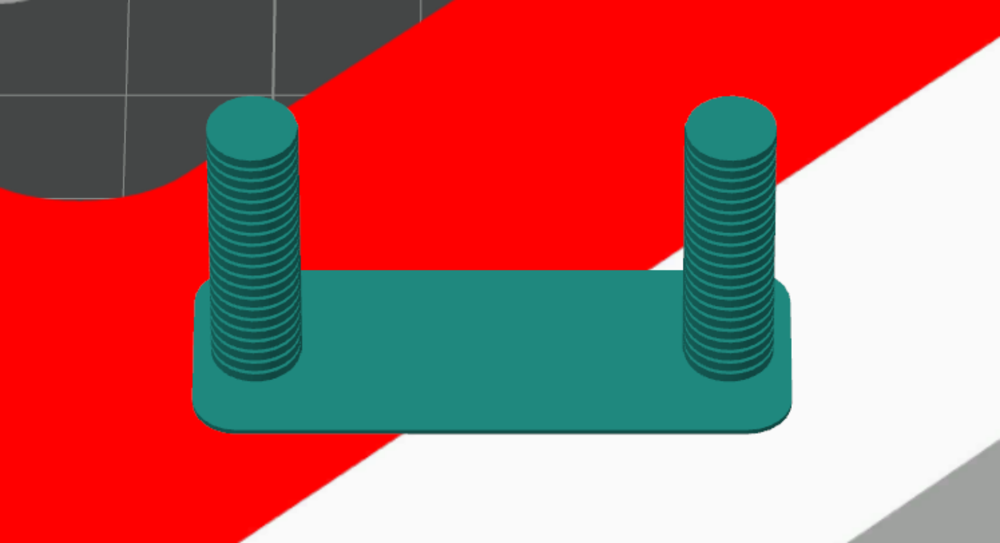

# Retraction

> Reference: [OrcaSlicer Wiki — Retraction Calibration](https://www.orcaslicer.com/wiki/calibration/retraction_calib.html)

**Applicable to:**

- All FDM printers.
- All non-foaming thermoplastic materials.

{height=3in}

---

## Purpose

Determine the best retraction length value that minimizes stringing and oozing without retracting so far that it causes clogging or under-extrusion, so the printed parts have good surface quality and the process stays stable.

## Preparation

1. Dry the filament thorougly.
2. Enable **Developer Mode** in the slicer preferences and ensure that **Calibration** menu shows up.

## Procedure

1. **Model**: Open the **Calibration** menu and select **Retraction Test**.
1. **Parameter setup**: 
   - Set **Start retraction length** $d_{\text{start}}$ to 0, **End retraction length** $d_{\text{end}}$ to 2 for direct drive or 6 for Bowden, and **Step** $d_{\text{step}}$ to 0.1.
   - Set temperature, cooling, maximum volumetric speed, and flow ratio according to previous calibration results.
2. **Preview check**: After slicing, ensure that the temperature, cooling, print speed and flow ratio settings match the intended values.
3. **Observe and record**: A good retraction length value should give the least stringing and no under-extrusion.   
   - Find where the overall print quality is the best, and measure the height in mm (each step is 1 mm, so the height value in mm is equivalent to the step number $n$)
   - Calculate **retraction length** $d_{\text{retract}}$:  
   $d_{\text{retract}} = d_{\text{start}} + d_{\text{step}} \times n$, update the retration length in filament settings. 

## Process record

- A picture of the printed retraction tower.

